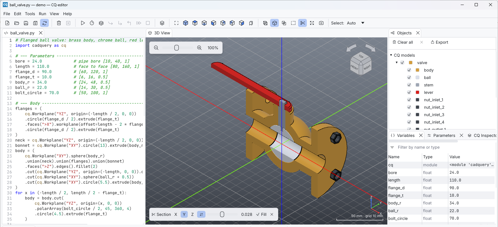
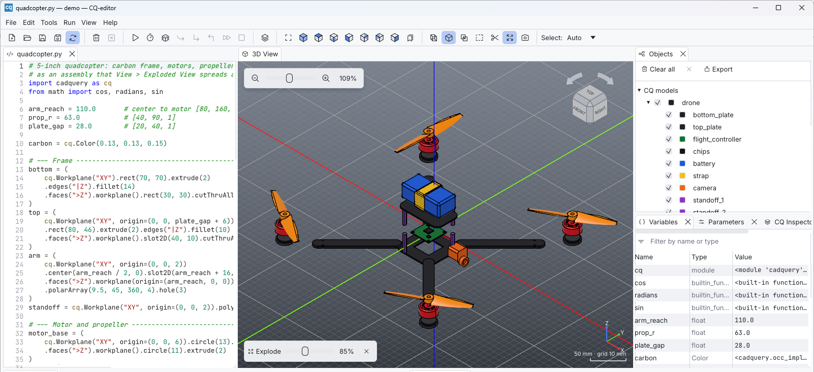

<h1 align="center">CQ-editor</h1>

<p align="center">
  <strong>The code editor and 3D viewer for <a href="https://github.com/CadQuery/cadquery">CadQuery</a>.</strong><br>
  Write Python, press <kbd>F5</kbd>, see your model. On Linux, Windows and macOS.
</p>

<p align="center">
  <a href="https://github.com/igors93/CQ-editor/actions/workflows/ci.yml"></a>
  <a href="https://doi.org/10.5281/zenodo.3955112"></a>
  <a href="LICENSE"></a>
  <a href="https://www.patreon.com/jmwright"></a>
  <a href="https://liberapay.com/jmwright"></a>
</p>

<p align="center">
  <picture>
    <source media="(prefers-color-scheme: dark)" srcset="docs/images/main-window-dark.png">
    
  </picture>
</p>

CadQuery models are Python programs: parametric, versionable and easy to
share. CQ-editor is the IDE built around that idea. You get an editor for
your script, a fast 3D view of the result, and the tools to understand how
the model was built: a debugger, a stack inspector and an interactive
console. Your code stays the single source of truth.

## Notable features

* **Automatic code reloading**: keep using your favorite editor; CQ-editor
  re-runs the script on every save, and never silently overwrites unsaved
  edits.
* **GPU-accelerated 3D view** with anti-aliasing, smooth camera animations,
  zoom at the mouse pointer, and turntable or trackball orbiting.
* **Navigation cube** with rotation arrows
  * always shows the current camera orientation;
  * click faces, edges or corners for one-click animated reorientation.
* **Precise selection** of faces, edges and vertices, with stable topological
  ids (*Selected Face 6 of bracket*).
* **Graphical debugger** for CadQuery scripts
  * step through the script (over, in, out) and watch the model change.
* **CadQuery object stack inspector**
  * visual inspection of the current workplane and selected items;
  * insight into the evolution of the model.
* **Export** to STEP (assemblies keep names and colors), STL and BREP.
* **Python console** that shares the variables of the last run.
* **Multi-file projects**: every file in a tab, a Project panel with the
  folder's files, and a main script that F5 renders while you edit its
  modules.
* **Robust by design**: scripts run in a separate Python process, so a long
  or crashing script never freezes or takes down the editor. Saves are
  atomic, and unsaved work is recovered after a crash.
* **Light and dark themes**, dockable panels that remember their layout.

<table>
  <tr>
    <td width="33%"></td>
    <td width="33%"></td>
    <td width="33%"></td>
  </tr>
  <tr>
    <td align="center"><sub>Step through a script</sub></td>
    <td align="center"><sub>Inspect how a model was built</sub></td>
    <td align="center"><sub>Select, measure and get the selector</sub></td>
  </tr>
  <tr>
    <td width="33%"></td>
    <td width="33%"></td>
    <td width="33%"></td>
  </tr>
  <tr>
    <td align="center"><sub>Cut the model with a section plane</sub></td>
    <td align="center"><sub>Explode assemblies</sub></td>
    <td align="center"><sub>Tune parameters with sliders</sub></td>
  </tr>
</table>

## Quick start

1. **Download the installer** for your computer from the
   [releases page](https://github.com/igors93/CQ-editor/releases):

   * Windows: `CQ-editor-0.9.0-Windows-x86_64.exe`;
   * macOS: the Apple Silicon or Intel `.pkg`;
   * Linux: the `.sh` installer (`chmod +x` it, then run it).

   Python, CadQuery and code completion are already included. Each release
   publishes SHA-256 checksums, and CI installs and starts every artifact
   before it is published.

2. **Launch CQ-editor** from the application menu. On Windows and Linux you
   can also choose CQ-editor from **Open with** for a `.py` file.

3. **Press F5.** Scripts are plain CadQuery; `show_object` decides what is
   displayed:

   ```python
   import cadquery as cq

   result = cq.Workplane("XY").box(40, 30, 12).edges("|Z").fillet(3)
   show_object(result, name="block", options={"color": "steelblue"})
   ```

New to CadQuery or CQ-editor? The [10-minute tour](docs/getting-started/first-model.md)
models a bracket step by step, and **File > Examples** has nine commented
scripts.

## Documentation

Everything is in the [`docs/`](docs/README.md) folder:

* [Installation](docs/getting-started/installation.md): requirements, how Python is found, where files are stored
* [Your first model](docs/getting-started/first-model.md): a guided tour
* [User guide](docs/README.md#user-guide): [interface](docs/user-guide/interface.md), [writing scripts](docs/user-guide/scripting.md), [3D view](docs/user-guide/viewer.md), [editor](docs/user-guide/editor.md), [projects](docs/user-guide/projects.md), [debugging](docs/user-guide/debugging.md), [console](docs/user-guide/console.md), [exporting](docs/user-guide/exporting.md), [preferences](docs/user-guide/preferences.md), [shortcuts](docs/user-guide/shortcuts.md), [troubleshooting](docs/user-guide/troubleshooting.md)
* [Development](docs/README.md#development): [architecture](docs/development/architecture.md), [worker protocol](docs/development/protocol.md), [building](docs/development/building.md), [testing](docs/development/testing.md), [CadQuery/OCP compatibility](docs/development/dependency-compatibility.md), [contributing](docs/development/contributing.md)
* [Roadmap](docs/roadmap.md) and [changelog](docs/changelog.md)

## How it works

The interface is a native Rust application built with
[egui](https://github.com/emilk/egui) and [wgpu](https://wgpu.rs). CadQuery
runs in a separate Python process, the *worker*. The worker executes
scripts, meshes the shapes and sends them to the interface. Its sources are
embedded in the executable. Release installers also carry a private, tested
Python/CadQuery environment; source builds can use any compatible environment
selected with `--python` or in Preferences.

```
┌──────────────────────────────┐   JSON lines    ┌─────────────────────────────┐
│ cq-editor (Rust)             │ ──────────────► │ python -m cq_worker         │
│ editor, 3D view, panels      │   stdin/stdout  │ runs scripts with CadQuery, │
│                              │ ◄────────────── │ meshes, debugger, export    │
└──────────────────────────────┘                 └─────────────────────────────┘
```

Scripts written for the original PyQt CQ-editor keep working: same
`show_object` options, same script namespace, same execution settings. See
[Architecture](docs/development/architecture.md) for the details. GUI
equivalence, deliberate changes and the remaining stereo and rich-console
gaps are tracked in the
[compatibility matrix](docs/development/compatibility.md); they are not
silently treated as equivalent.

## Getting Help

For general questions and discussion about CQ-editor, please create a
[GitHub Discussion](https://github.com/igors93/CQ-editor/discussions). For
CadQuery itself, see the [CadQuery documentation](https://cadquery.readthedocs.io/en/latest/).

## Reporting a Bug

If you believe that you have found a bug in CQ-editor, please make sure that:

* you are using the latest CQ-editor release;
* you have searched the [issue tracker](https://github.com/igors93/CQ-editor/issues)
  and the [roadmap](docs/roadmap.md#1-bugs-and-problems) to make sure the bug
  is not already known.

Then file a [new issue](https://github.com/igors93/CQ-editor/issues/new)
with:

* the operating system and its version (on Linux, the distribution and its
  version);
* how CQ-editor was installed (release download or built from source, and
  which commit);
* the Python and CadQuery versions (shown in the status bar and in *Help >
  About*);
* the steps to reproduce the bug, ideally with a small script;
* the relevant lines from the Log panel or, after a crash, from the log file
  `logs/cq-editor.log` in the [application data
  folder](docs/getting-started/installation.md#where-cq-editor-keeps-its-files).

## Contributing

Contributions are welcome. Start with [Contributing](docs/development/contributing.md)
and pick something from the [roadmap](docs/roadmap.md).

## License

CQ-editor is licensed under the [Apache License 2.0](LICENSE). The bundled
Inter and JetBrains Mono fonts are under the SIL Open Font License 1.1 (see
[`assets/fonts`](assets/fonts/README.md)).
