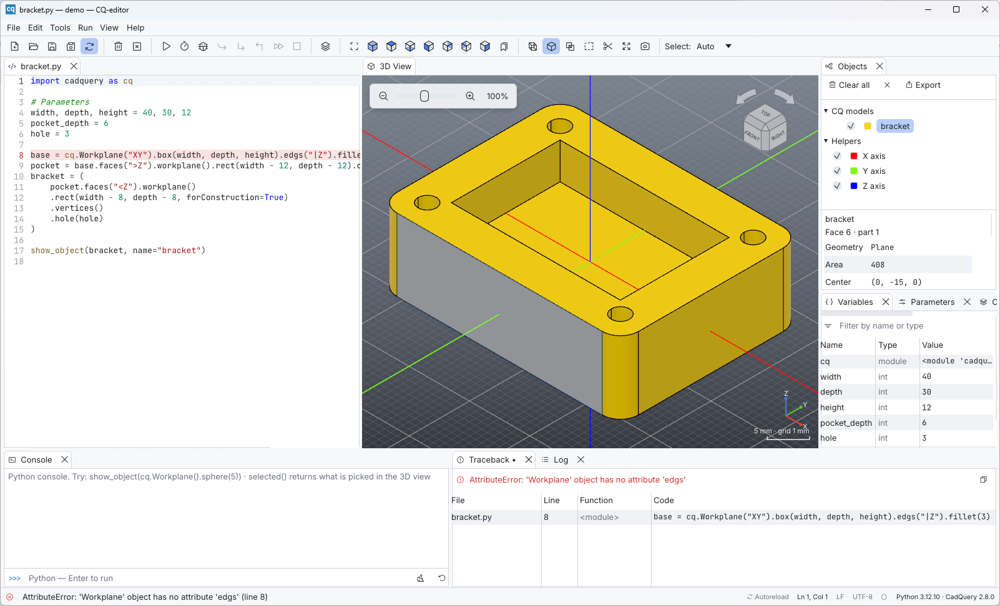

# Your first model

This tour takes about ten minutes. You will model a small bracket, change its
dimensions, select faces in the 3D view, find a bug with the debugger and
export the result. It assumes CQ-editor starts and the status bar shows the
Python and CadQuery versions (see [Installation](installation.md)).

## 1. Write the script

Choose **File > New** (Ctrl+N) and type, or paste, this script:

```python
import cadquery as cq

# Parameters
width, depth, height = 40, 30, 12
pocket_depth = 6
hole = 3

base = cq.Workplane("XY").box(width, depth, height).edges("|Z").fillet(3)
pocket = base.faces(">Z").workplane().rect(width - 12, depth - 12).cutBlind(-pocket_depth)
bracket = (
    pocket.faces("<Z").workplane()
    .rect(width - 8, depth - 8, forConstruction=True)
    .vertices()
    .hole(hole)
)

show_object(bracket, name="bracket")
```

Save it with **File > Save** (Ctrl+S). An untitled buffer asks where to save
it; call it `bracket.py`. Saving matters for two reasons: the script's folder
becomes its working directory, and automatic reload needs a file to watch.

## 2. Render

Press **F5** (or the ▷ button). The model appears in the 3D view, the
**Objects** panel lists `bracket`, and the status bar reports something like
*Rendered 1 object in 0.09 s*.


`show_object` is how a script tells the editor what to draw. It also accepts
a color:

```python
show_object(bracket, name="bracket", options={"color": "steelblue", "alpha": 0.8})
```

[Writing scripts](../user-guide/scripting.md) covers all the options.

## 3. Change a parameter

CadQuery models are parametric: dimensions are plain Python variables. Change
`hole = 3` to `hole = 5` and press **F5** again. The view frames the new
model (turn off *Preferences > 3D View > Fit automatically* to keep the
camera where it is).

To work in another editor (VS Code, vim, …) instead, turn on **File >
Automatic Reload and Preview**. CQ-editor then re-runs the script every time
the file changes on disk. If you also have unsaved edits in CQ-editor, it
asks before replacing them (see [Code editor](../user-guide/editor.md#automatic-reload-and-preview)).

## 4. Look around

| Do this | To |
| --- | --- |
| Left drag | Orbit |
| Middle drag, or Ctrl + left drag | Pan |
| Mouse wheel | Zoom at the pointer |
| Click a face, edge or corner of the navigation cube | Look from that direction |
| Click the curved arrows above the cube | Roll the view by 45° |
| Shift+F1 / Shift+F2 | Fit the model / isometric view |
| Double-click the model | Zoom to it |

## 5. Select a face

Click a face of the bracket. The face is highlighted, the status bar reads
*Selected Face 6 of bracket*, and the Objects panel shows the entity under
the object's name. Edges and vertices can be picked the same way; the pointer
only needs to be within a few pixels of them.


The numbers are stable topological ids: the same face keeps its number as
long as the geometry does not change.

## 6. Make a mistake on purpose

Change `.edges("|Z")` to `.edgs("|Z")` and press **F5**. The run fails:

* the offending line is highlighted in red in the editor;
* the status bar shows the error and its line;
* the **Traceback** panel lists the stack. Click a row to jump to that line.



The previous model stays on screen until the next successful run. Fix the
typo before going on.

## 7. Step through the script

Click the line number of line 9 (`pocket = …`). A red dot marks a breakpoint.
Now choose **Run > Debug** (Ctrl+F5):

* the script runs until it reaches line 9, which is highlighted;
* the 3D view shows the CadQuery objects that exist at that point (`base`);
* the **Variables** panel lists the local variables.


Press **Step** (Ctrl+F10) to run one line and watch `pocket` appear, or
**Continue** (Ctrl+F12) to run to the next breakpoint or to the end. **Run >
Stop Debugging** (Ctrl+F5 again) ends the session. More in [Debugging and
inspection](../user-guide/debugging.md).

## 8. Inspect how the model was built

Select `bracket` in the Objects panel and open the **CQ Inspector** tab. It
lists the chain of CadQuery operations that produced the object, newest
first. Turn on **Show in view** and click a step: its objects and its
workplane grid are drawn over the model.

## 9. Export

Choose **Tools > Export as STEP…** (or STL, or BREP). The selected objects
are exported, or all of them when nothing is selected. The **Export** button
in the Objects panel does the same.

## Where next

* **File > Examples** has nine commented scripts, from a simple box to
  assemblies such as a welded square-tube workbench. Examples open
  read-only; saving asks for a new location.
* The **Console** panel runs Python with the variables of the last run. Try
  `show_object(bracket.faces(">Z"))`.
* [The interface](../user-guide/interface.md) walks through every panel and
  menu.
* The [CadQuery documentation](https://cadquery.readthedocs.io/en/latest/)
  is the reference for modeling itself.
