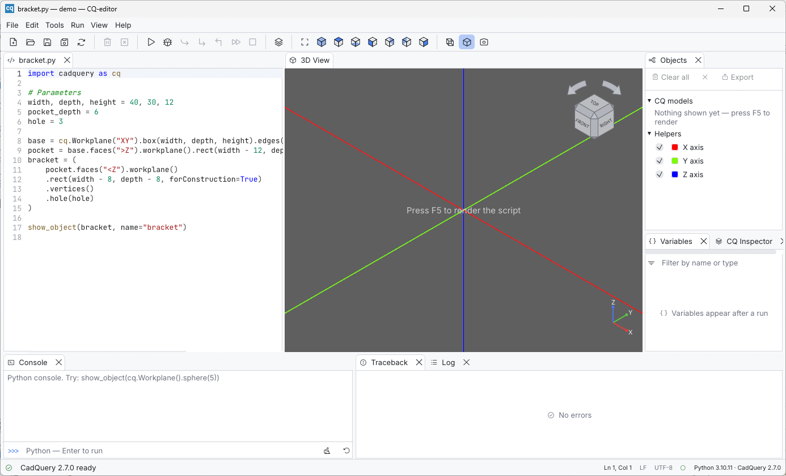

# Installation

CQ-editor has two parts:

* **the editor**, a single native executable (`cq-editor`, or `cq-editor.exe`
  on Windows);
* **a Python environment with CadQuery**, which the editor starts in the
  background to run your scripts.

The Python code the editor needs (the `cq_worker` package) is embedded in the
executable. You do not install it separately.

## Requirements

| | Minimum |
| --- | --- |
| Operating system | Windows 10/11, Linux (X11 or Wayland), macOS. CI builds and tests all three |
| Python | 3.10–3.14, with a matching supported CadQuery version installed |
| Optional | `jedi`, for code completion and call signatures in the editor and console |
| Graphics | A GPU and driver supported by [wgpu](https://wgpu.rs) (Vulkan, Metal or Direct3D 12) |
| Building from source | Rust 1.88 or newer (stable toolchain) |

## 1. Install CadQuery

Use any environment manager you like. The editor only needs to find the
`python` executable of that environment (see [How CQ-editor finds
Python](#how-cq-editor-finds-python)).

Python 3.11–3.14 with CadQuery 2.8 is recommended. Python 3.10 remains
supported with CadQuery 2.7. The exact tested combinations, including their
OCP versions, are in the
[CadQuery/OCP compatibility matrix](../development/dependency-compatibility.md).

**pip and a virtual environment**

```sh
python -m venv .venv
# Windows:      .venv\Scripts\pip install cadquery jedi
# Linux/macOS:  .venv/bin/pip install cadquery jedi
```

**conda / mamba**

```sh
mamba create -n cadquery -c conda-forge cadquery jedi
mamba activate cadquery
```

Check that CadQuery imports:

```sh
python -c "import cadquery; print(cadquery.__version__)"
```

## 2. Get CQ-editor

### Download a release

When a release is published, the *Build Executables* workflow
(`.github/workflows/release.yml`) attaches executables for Linux x86_64,
Windows x86_64 and macOS arm64 to the
[GitHub release](https://github.com/CadQuery/CQ-editor/releases). Download the
file for your system. It is the whole application.

### Build from source

```sh
git clone https://github.com/CadQuery/CQ-editor.git
cd CQ-editor
cargo build --release
```

The executable is written to `target/release/cq-editor` (`cq-editor.exe` on
Windows). Linux needs a few system packages first, and Windows has two
toolchain options. [Building](../development/building.md) covers both.

## 3. Run it

```sh
cq-editor                      # reopens the last file, or shows a starter script
cq-editor my_part.py           # opens a script
cq-editor --python /path/to/env/bin/python my_part.py
```

| Option | Meaning |
| --- | --- |
| `FILE` | CadQuery script to open |
| `--python PATH` | Python interpreter to use for this session. It overrides the preferences |
| `-h`, `--help` | Print the usage text |

On the first start the status bar shows **Starting Python…** while CadQuery
is imported, which takes a few seconds. It then shows the versions in use,
for example **Python 3.12.10 · CadQuery 2.8.0**. Hover it to also see the OCP
version, and press **F5** to render.



If the interpreter cannot import CadQuery, a **CadQuery is not available**
dialog names the interpreter that was tried. Install CadQuery there, or choose
another interpreter in **Edit > Preferences > General > Python interpreter**
and click **Restart Python with this interpreter**.

## How CQ-editor finds Python

The first match wins (`src/worker/launch.rs`):

1. the `--python PATH` command-line option, or else the interpreter set in
   *Preferences > General* (when not empty);
2. the `CQ_EDITOR_PYTHON` environment variable;
3. the active virtual environment (`VIRTUAL_ENV`) or conda environment
   (`CONDA_PREFIX`);
4. a `.venv` folder next to the executable or in the current working
   directory (debug builds also look in the source tree);
5. `python` (Windows) or `python3` (Linux, macOS) from `PATH`.

Starting CQ-editor from a terminal where your environment is activated is
usually enough.

## Where CQ-editor keeps its files

Everything lives in one per-user folder:

| System | Folder |
| --- | --- |
| Windows | `%APPDATA%\cq-editor\data\` |
| Linux | `~/.local/share/cq-editor/` |
| macOS | `~/Library/Application Support/cq-editor/` |

| Entry | Content |
| --- | --- |
| `app.ron` | Preferences, recent files, panel layout and window position |
| `recovery/` | Crash-recovery session and local history (see [Code editor](../user-guide/editor.md#crash-recovery-and-local-history)) |
| `logs/` | `cq-editor.log`, everything the Log panel shows, and the previous part `cq-editor.1.log` (see [Troubleshooting](../user-guide/troubleshooting.md#reporting-a-problem)) |
| `worker-<hash>/` | The extracted copy of the embedded Python worker. A new version removes the folders of earlier ones |

Deleting `app.ron` while the editor is closed restores all defaults.

## Next step

Follow [Your first model](first-model.md).
