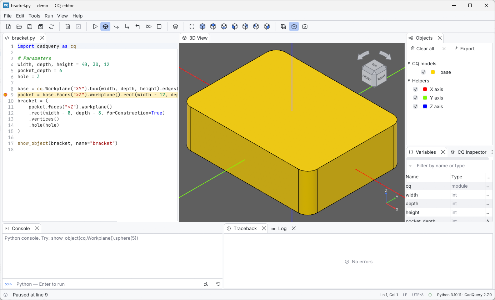
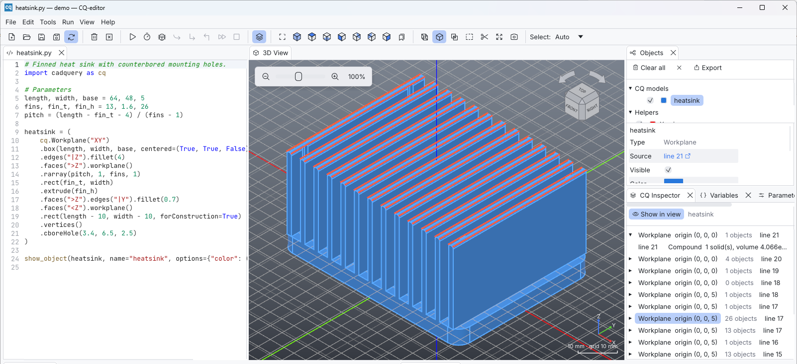

# Debugging and inspection

Two tools help you see *how* a model is built, not only the result:

* the **debugger** runs the script line by line and shows the model as it
  grows;
* the **CQ Inspector** replays the chain of CadQuery operations behind any
  workplane.

## The debugger

### Starting a session

1. Click line numbers to set breakpoints (red dots).
2. Choose **Run > Debug** (Ctrl+F5, toolbar bug icon).

As in the original CQ-editor, the script **runs until the first
breakpoint**. Without breakpoints it runs to the end, so set at least one.
The 3D view is cleared when the session starts.

### While paused

* The paused line is highlighted and the status bar reads *Paused at line N*.
* The **3D view** shows every CadQuery object among the local variables of
  the paused frame, so you see the model at that exact point.
* The **Variables** panel lists those locals.
* Completion, the CQ Inspector and export still work. Requests that would
  change the session (another run, the console) are refused with *Not
  available while debugging; continue or stop first*.
* You can add or remove breakpoints. They take effect with the next step.

### Stepping

| Command | Shortcut | What it does |
| --- | --- | --- |
| Step | Ctrl+F10 | Run the current line, stepping over function calls |
| Step In | Ctrl+F11 | Stop at the next line, entering functions defined in the script |
| Step Out | Ctrl+Shift+F11 | Run until the current function returns |
| Continue | Ctrl+F12 | Run to the next breakpoint, or to the end |
| Stop Debugging | Ctrl+F5 | End the session |

The debugger traces the main script and Python modules inside the project
folder. Set breakpoints in their tabs; the paused module opens at its line.
CadQuery and OpenCascade libraries run at full speed. Closing the tab of the
script being debugged, or the module currently paused, ends the session.

When the session ends, normally or with *Stop Debugging*, the view shows
what the script displayed, or the CadQuery objects that existed when it
stopped.

### Stopping a runaway script

**Run > Stop** (Ctrl+Shift+F5) first asks the script to stop, as Ctrl+C
would in a terminal: Python raises `KeyboardInterrupt` where the script is,
so a loop or a `time.sleep` stops at once, and the status bar says at which
line. Python keeps running, with the console's variables and the meshes it
has cached. Native code (a long OpenCascade operation) only notices when it
returns to Python; if the script has not stopped after 3 seconds, or if you
press Stop again, Python is restarted instead. A paused debugging session is ended
by the debugger, as with *Stop Debugging*.

After a restart the console's variables are lost. The objects on screen
stay; render again before exporting or inspecting them.

## CQ Inspector

A CadQuery `Workplane` remembers the chain of workplanes that produced it.
The inspector shows that chain for the selected object:

1. Select a workplane object in the Objects panel (or in the view).
2. Open the **CQ Inspector** tab.

Each row is one step of the chain, **newest first**, with the workplane's
origin and the number of objects on its stack. Expand a step to see its
objects with a short description, for example *Compound 1 solid(s), volume
1.09e+04*, *face plane, area 120*, *edge line, length 30* or a vertex
position.

Turn on **Show in view** to overlay the selection on the model. **Tools >
Inspect CQ Object** and the layers button in the toolbar toggle the same
option.

* click a **step** to draw all of its objects together with a grid on its
  **workplane**;
* click a single **object** to draw only that object.

The **line N** button of a step or an object goes to the script line that
made it, so the chain can be followed in the code.

This is the quickest way to understand selectors such as
`.faces(">Z").workplane()` or `.vertices()`: you see which plane the next
operation is relative to, and which entities it acts on.

Only workplanes have a construction chain. Shapes, sketches and assemblies
show *Select a workplane in Objects to inspect it*.

## Debugging tips

When a recognized CadQuery operation fails with a related kernel or selector
error, the **Traceback** panel shows possible CAD causes above the original
Python traceback. The operation and script line are linked; click its line
button to return to the code. These hints are troubleshooting suggestions,
not a geometric diagnosis proven by OpenCascade. The full traceback remains
available for copying, and ordinary Python errors receive no CAD advice.

* **Check a selection without changing the model:** `debug(part.edges("|Z"))`
  draws the edges in translucent red.
* **Measure from the console:** after a run, `bracket.val().Volume()` or
  `bracket.faces(">Z").val().Center()`.
* **Find which line breaks:** when a CadQuery operation fails with an
  OpenCascade error such as `StdFail_NotDone`, set a breakpoint just before
  it. Inspect the inputs in the view and the inspector, then step over it.
* **Selected face ids** (*Selected Face 6 of bracket*) tell you which entity
  you clicked. Compare them with what your selector returns.
