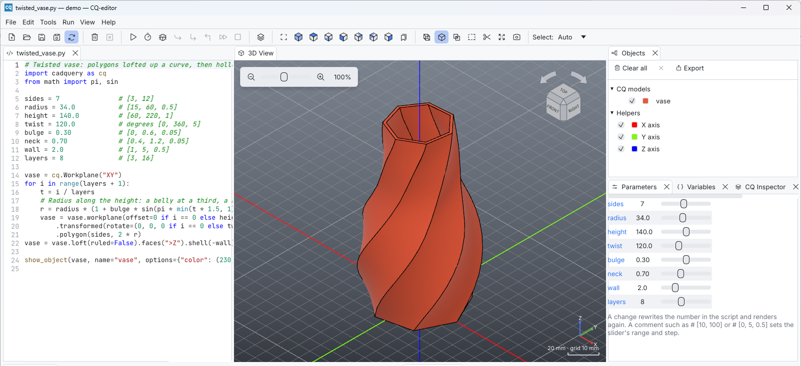

# Code editor

The editor is built for short CadQuery scripts: Python highlighting, smart
indentation, completion, documentation on hover, search and replace, and
breakpoints. It also takes care that your work is never lost.

## Editing

| Feature | How |
| --- | --- |
| Syntax highlighting | Automatic. Colors follow the light or dark theme |
| Line numbers, current line | Always shown. The current-line highlight can be turned off |
| Vertical ruler | At column 79 by default (*Maximum line length*, 0 hides it) |
| Indent / unindent | Tab / Shift+Tab. With several lines selected, Tab indents them all. Indentation is 4 spaces |
| Auto-indent | Enter keeps the indentation, indents after a line ending with `:` and dedents after `return`, `pass`, `break`, `continue` or `raise` |
| Toggle comment | Ctrl+/ comments or uncomments the selected lines |
| Undo / redo | Ctrl+Z / Ctrl+Y (or Ctrl+Shift+Z), also in the **Edit** menu. Typing is undone a burst at a time: a pause, a new line or a click elsewhere starts the next step. An indent, a comment, an accepted completion, a *Replace all* and a reload from disk are each one step. Each tab has its own history |
| Go to line | Ctrl+G opens a bar above the editor: type a line, or `line:column`, and press Enter |
| Line wrap | Off by default (*Preferences > Editor*) |
| Font size | 13 by default (8–28) |

## Completion and call signatures

Completion opens by itself after you type `.` (for example `cq.` or
`result.`), and once you have typed the first three characters of a name
(*Preferences > Editor > Complete names after*; 0 turns that off). Press
**Ctrl+Space** (or **Alt+/**) to complete the name under the cursor at any
other time:

* a popup lists matching names (up to 200) and filters as you keep typing;
* **↑/↓** choose, **Enter** or **Tab** accept, **Esc** closes;
* right after `(` or `,`, the call signature of the function is shown
  instead, for example the parameters of `Workplane.box`.

Completion runs in the Python worker with [jedi](https://github.com/davidhalter/jedi).
It knows the script API (`show_object`, `cq`, …) and anything importable from
the selected environment. Install `jedi` in that environment to enable it.
Without jedi, the command does nothing.

## Documentation on hover

Rest the mouse pointer on a name for a moment to see its documentation in a
tooltip: the call signature and docstring of a function or class (for
example `Workplane.box`), the docstring of a module, or the type a variable
holds (`box: Workplane`). It also comes from jedi, and appears only while
no script is running.

## Selector preview

After rendering, place the caret inside a literal selector call such as
`part.faces(">Z")`, `part.edges("|Z")` or `part.vertices(">X")`. Matching
entities light up in the 3D view, and **Measurements** shows the match count
or why a preview is unavailable. The highlight is temporary and does not
change the user's selection. It updates after a short pause while moving the
caret and disappears when the caret leaves the call or the script changes.

The receiver must be a variable from the last successful run that is shown
in the view. The selector must be a literal string. Expressions that compute
the receiver or selector are not run merely to provide a preview. Render the
script again after editing it; old topology IDs cannot be reused safely.

## Search

**Ctrl+F** opens the search bar above the editor:

* matches are highlighted as you type, and the bar shows *N of M* (or *No
  matches*);
* **Enter** / **Shift+Enter** go to the next / previous match after the
  cursor. From the editor, use **F3** / **Alt+F3**;
* **Aa** toggles *Match case*, and **ab** *Whole word*, which skips the
  term inside longer names (`box` but not `boxes`);
* **Esc** closes the bar.

**Ctrl+H** (or the ⇄ button of the bar) shows the replace row. **Replace**
(or Enter in its field) replaces the selected match and selects the next
one; when no match is selected it first selects the next one, so nothing is
replaced unseen. **Replace all** replaces every match at once, as a single
step to undo.

## Breakpoints and markers

Click a line number to toggle a **breakpoint** (red dot). Breakpoints stay
on their statements while you edit: adding or removing lines above one moves
it along, and deleting its line removes it.

Breakpoints are **remembered per file** across sessions (for the last 100
files). Each is saved with the text of its line, so if the file changed in
another editor meanwhile, it returns to the line with that text, or is
dropped when no line has it any more. The gutter and line backgrounds also
show:

* the **current debug line** (yellow) while a debugging session is paused;
* the **error line** (red) after a failed run;
* the **time of each line** after a profiled run (below).

See [Debugging and inspection](debugging.md).

## Profiling

**Run > Profile** (Alt+F5, toolbar stopwatch) renders the script and measures
where the time goes. The gutter then shows, next to the line numbers, the
time each line took **with everything it called**: a line calling a slow
function of the script shows that function's time too, and the function's
own lines show theirs. The slowest lines are the most orange; lines that took
less than a millisecond stay blank. The status bar names the slowest line.

Hover a time for details: how many times the line ran (in a loop) and its
calls into CadQuery by operation, slowest first, for example
`Workplane.fillet: 1.2 s (3 calls)`.

The times follow your edits, like breakpoints, until the next run, which
clears them; **Run > Clear Profile** removes them at once. A script that
fails is profiled up to its error. Profiling slows Python-heavy code
somewhat (CadQuery's geometry work happens in OpenCascade and is not
slowed), and a debugging session is never profiled.

## Files

| Command | Shortcut | Notes |
| --- | --- | --- |
| New | Ctrl+N | Empty untitled script, in a new tab |
| Open… | Ctrl+O | Python files (`*.py`), several at once, each in a tab |
| Open Folder… | Ctrl+Shift+O | Shows the folder in the Project panel |
| Open Recent | | The last 10 files, then recent folders |
| Save | Ctrl+S | Untitled scripts and examples ask for a location |
| Save As… | Ctrl+Shift+S | |
| Save All | | Every tab with unsaved changes |
| Close Tab | Ctrl+W | Asks first when the tab has unsaved changes |
| Quit | Ctrl+Q | |

* Every open file has a **tab**; see [Projects and multiple
  files](projects.md) for tabs, the Project panel and the main script.
* CQ-editor reopens the tabs of the last session when it starts, and shows
  the file that was shown. A file given on the command line is opened too,
  and shown.
* Closing a tab, closing the window or quitting with unsaved changes asks
  **Save**, **Don't save** or **Cancel**, once for all the files concerned.
* **Examples** (File > Examples) open as read-only buffers. You can edit and
  run them; saving asks for a new location.

### Encoding and line endings

Files are read and written as **UTF-8**. When a file is not valid UTF-8,
CQ-editor asks before doing anything: **Open as Windows-1252** reads it with
the Western European encoding of older Windows editors, without changing the
file. Saving it then writes UTF-8, the encoding Python expects; until then
the status bar shows *Windows-1252 → UTF-8*. **Cancel** leaves the file
alone. A UTF-8 byte order mark and the file's line endings (LF, CRLF or CR)
are preserved on save. The status bar shows the encoding and the line
endings.

### Safe saving

Saves are **atomic**: the new contents are written to a temporary file next
to the script and then swapped in. A crash or power loss in the middle of a
save leaves either the old or the new file, never a truncated one.

## Parameters panel

The **Parameters** panel lists the script's top-level numbers, such as
`width = 40` or `wall: float = 2.5`, each with a spin box and a slider.
Changing a value rewrites its literal in the script and renders again once
the value stops changing for a moment, so the script stays the source of
truth: the change is an ordinary edit (a whole drag is one Undo step), and
saving keeps it. Click a name to go to its line.



Integers stay integers, and floats keep the decimals they are written with
(`2.50` moves by 0.01). A comment after the value sets the slider's range,
optionally with a step, and bounds the value:

```python
width = 40          # [10, 100]
hole = 2.5          # diameter [0.5, 5, 0.25]
count = 3           # 1..12
```

Without a range, the slider spans from zero to twice the first value.
Only plain assignments at the start of a top-level line count: numbers
inside functions or blocks, bracketed or continued lines, strings, and
expressions such as `a = 1 + 2` are left alone. Values cannot be changed
while debugging.

## Automatic reload and preview

Turn on **File > Automatic Reload and Preview** (toolbar ⟳) to edit the
script in your favorite editor while CQ-editor shows the result:

* the file is checked every 250 ms, and the script re-runs after it changes.
  Editors that save by deleting and recreating the file (vim, neovim) are
  supported;
* *Autoreload delay* (default 50 ms) waits for the other editor to finish
  writing;
* *Autoreload: watch imported modules* also re-runs when local modules
  imported by the script change;
* a save that only touches the timestamp, without changing the contents,
  does not re-run anything;
* the other open tabs are watched too, and reloaded when another program
  changes their file (see [Projects and multiple
  files](projects.md#automatic-reload)).

### When the file changes while you have unsaved edits

CQ-editor never silently throws away your edits. If the file on disk changes
while the buffer has unsaved changes that differ from it, the **File changed
on disk** dialog appears:

| Choice | Result |
| --- | --- |
| **Keep my version** | The buffer is unchanged. Saving later overwrites the disk version, which is first kept in the local history |
| **Reload from disk** | The disk version replaces the buffer. Your edits are first saved as a recovery backup, whose path is shown in the status bar and the log |
| **Save a copy…** | Saves your edits under another name (`<name>.local-copy.py` by default), then reloads the disk version |
| **Compare changes** | Shows both versions side by side before you decide |

If the disk version matches your buffer, nothing is lost and the reload
happens without a question.

Saving checks the file too, with or without automatic reload. If another
program (git, another editor, a formatter) changed it since you opened or
last saved it, nothing is written: the same dialog asks first, with
**Save my version** (the other version is kept in the local history before
it is replaced) and **Cancel** in place of *Keep my version*.

## Crash recovery and local history

While a buffer has unsaved changes, CQ-editor writes a **recovery
checkpoint** every 5 seconds (and before risky operations such as reloading
or saving).

* **After a crash** or a forced shutdown, the next start shows **Unsaved work
  can be recovered**, with the time of the checkpoint and every file that
  had unsaved changes. Choose **Restore session**, which puts each back in
  its tab, or **Discard recovery**.
* **File > Local History…** lists earlier versions of the current document:
  checkpoints, saved versions and the contents a *Save As* replaced. Select
  one to preview it, then **Restore this version**. The newest **20
  versions per document** are kept. Versions older than 90 days are removed,
  which also clears the history of files you deleted or renamed, and the
  oldest versions go first when the whole history exceeds 64 MB.

Recovery data stays on your computer, in the `recovery/` folder of the
[application data folder](../getting-started/installation.md#where-cq-editor-keeps-its-files).
Saving a file, or a deliberate *Don't save*, takes it out of the recovery
session; the session ends once no tab has unsaved changes.
