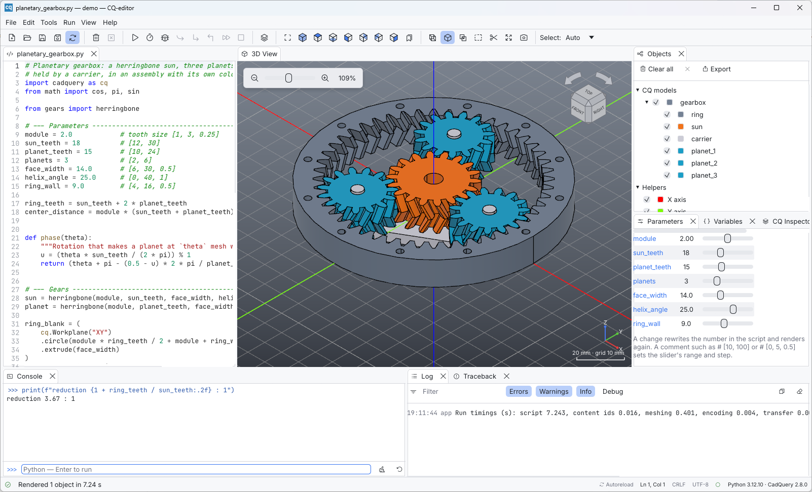
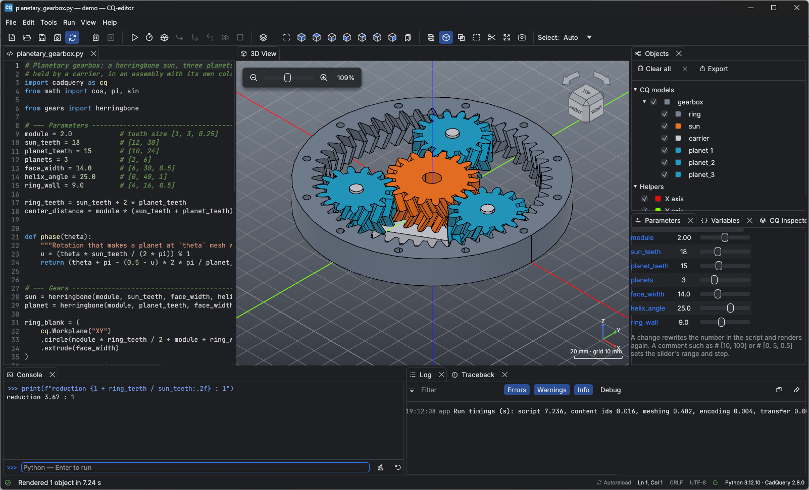

# The interface



The window has one idea: **the script is the model**. The code editor sits on
the left and the 3D view in the center. The panels around them help you
understand what the code produced.

```
┌───────────────────────────── menu bar · toolbar ─────────────────────────────┐
│ Editor             │ 3D View                         │ Objects               │
│ (your script)      │ (navigation cube, axes)         ├───────────────────────┤
│                    │                                 │ Variables · Inspector │
├────────────────────┴───────────────┬─────────────────┴───────────────────────┤
│ Console                            │ Traceback · Log                         │
├────────────────────────────────────┴─────────────────────────────────────────┤
│ status messages              Ln, Col · line ending · UTF-8 · Python/CadQuery │
└──────────────────────────────────────────────────────────────────────────────┘
```

## Panels

Every panel is a dockable tab. Drag a tab to move it, drop it on another
panel to stack it, or close it. **View** lists all panels as toggles, and
**View > Reset Layout** restores the arrangement above. The layout is saved
between sessions.

| Panel | Purpose | Details |
| --- | --- | --- |
| **Editor** | The script, with highlighting, breakpoints and completion | [Code editor](editor.md) |
| **3D View** | The rendered model, navigation cube, axes indicator | [3D view](viewer.md) |
| **Objects** | Tree of shown objects and helpers (X/Y/Z axes), with visibility toggles and a property sheet (type, visibility, color, opacity, size, triangle count) | [below](#objects-panel) |
| **Measurements** | Exact OCCT properties for one selected face, edge or vertex, and distance/angle for two | [3D view](viewer.md#exact-measurements) |
| **Parameters** | The script's top-level numbers as spin boxes and sliders; a change rewrites the line and renders again | [Code editor](editor.md#parameters-panel) |
| **Variables** | Name, type and value of the script's variables after a run, or of the locals while debugging | [Console, variables and logs](console.md#variables) |
| **CQ Inspector** | The construction stack of the selected workplane | [Debugging and inspection](debugging.md#cq-inspector) |
| **Console** | Interactive Python sharing the last run's variables | [Console, variables and logs](console.md) |
| **Traceback** | The last error, frame by frame; click a row to jump to the line | [Console, variables and logs](console.md#traceback) |
| **Log** | `print` output, `log()` messages, warnings from Python and OpenCascade | [Console, variables and logs](console.md#log) |

### Objects panel

* **CQ models** lists what the script showed. Assemblies appear as a tree
  with one node per part (or as a single object with *Merge assemblies*).
* **Helpers** holds the X, Y and Z axes.
* The checkbox toggles visibility. The color square is the object's color.
* Click to select, Ctrl+click to add to the selection, double-click to zoom
  to the object.
* Right-click opens a menu with **Zoom to**, **Show/Hide**, export and
  removal.
* The toolbar at the top has **Clear all**, **Remove selected** (×) and
  **Export** (the selection, or everything when nothing is selected).
* The property sheet below the tree edits the selected object: visibility,
  **Color** (with **Reset** to go back to the script's colors), **Opacity**,
  and shows its **Size** and **Triangles**. When a face, edge or vertex is
  selected, its id is shown too (for example *Face 6 · part 1*) with its
  exact measurements: the surface or curve type, the **Area** of a face,
  the **Length** of an edge, a **Radius** when there is one, and the
  **Center** (the **Position** of a vertex). Its **Selector** row has
  buttons to copy the CadQuery selector of the picked entities or insert it
  at the editor's cursor (see [Selection to code](viewer.md#selection-to-code)).

Colors and visibility changed here last until the next run. Turn on
*Preferences > Objects > Preserve properties on reload* to keep them across
runs (objects are matched by name).

## Toolbar

From left to right:

| Group | Buttons |
| --- | --- |
| File | New, Open, Save, Save as, Automatic reload and preview |
| Objects | Clear all objects, Clear current object |
| Run | Render, Debug, Step, Step in, Step out, Continue, Stop |
| Inspect | Inspect CQ object |
| View | Fit, then Iso, Top, Bottom, Front, Back, Left, Right |
| Display | Wireframe, Shaded, Screenshot |
| Selection | Auto, Object, Face, Edge or Vertex drop-down |

Buttons that cannot be used right now (for example *Step* when no debugging
session is paused) are disabled. Hover a button to see its shortcut.

## Menus

| Menu | Items |
| --- | --- |
| **File** | New · Open… · Open Recent · Save · Save As… · Local History… · Automatic Reload and Preview · Examples · Quit |
| **Edit** | Undo · Redo · Toggle Comment · Auto-Complete · Search · Replace · Go to Line… · Copy Selector · Insert Selector · Preferences… |
| **Tools** | Export as STEP… · Export as STL… · Export as BREP… · Inspect CQ Object · Screenshot… · Upload Model… |
| **Run** | Render · Debug / Stop Debugging · Step · Step In · Step Out · Continue · Stop · Clear Console · Clear Log · Restart Python |
| **View** | Fit · Zoom to Selection · Iso · Top · Bottom · Front · Back · Left · Right · Wireframe · Shaded · Perspective Projection · panel toggles · Reset Layout |
| **Help** | Documentation · CadQuery Documentation · Check for CadQuery Updates · About |

All shortcuts are listed in the [keyboard and mouse reference](shortcuts.md).

## Status bar

* **Left:** the latest status message with an icon: success (*Rendered 1
  object in 0.09 s*), information, warning or error (*AttributeError: …
  (line 4)*).
* **Right:** an *Autoreload* indicator when automatic reload is on, the
  cursor position (*Ln, Col*), the file's line ending (*LF*, *CRLF* or
  *CR*), the encoding (*UTF-8*) and the state of Python: *Starting Python…*,
  *Python 3.x · CadQuery 2.x*, *Python not started* or *Python unavailable*.
  Hover the Python state to see the CadQuery and OCP versions and which
  interpreter is used.

The window title shows the file name and folder, for example
*bracket.py — demo — CQ-editor*. An asterisk after the name in the title,
and a dot on the editor tab, mark unsaved changes. A dot on the Traceback
tab means the last run failed.

## Themes and scale

*Preferences > General > Theme* chooses **System** (default), **Light** or
**Dark**. The editor's syntax colors follow the theme.



*Interface scale* (0.75–2.0) zooms the whole interface on top of the system
scale. Ctrl + plus and Ctrl + minus do the same while you work.

## Python status and long runs

Scripts run in a separate Python process, so the window always stays
responsive:

* **Run > Stop** (Ctrl+Shift+F5) aborts a script that takes too long by
  restarting Python.
* If Python crashes (for example inside OpenCascade), the status bar says so
  and a fresh Python process starts on its own.
* **Run > Restart Python** starts a fresh process on demand, for example
  after installing a package.

A restart forgets the console's variables. The objects stay on screen, but
the new Python process does not know them: render again before exporting
or inspecting them.
