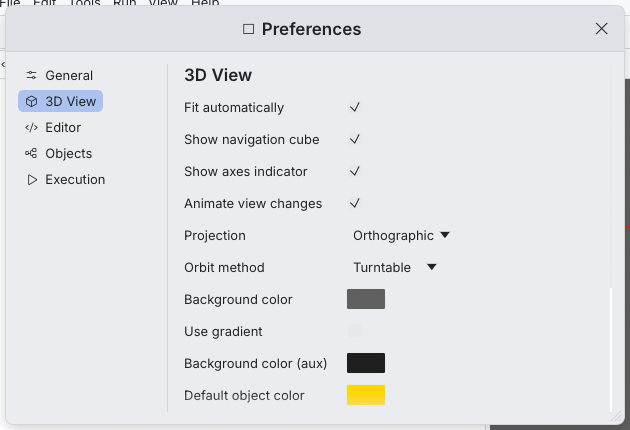

# Preferences

**Edit > Preferences…** (Ctrl+,) opens the preferences window. Changes apply
immediately and are saved with the rest of the application state in
`app.ron` (see [where files are stored](../getting-started/installation.md#where-cq-editor-keeps-its-files)).
**Restore defaults**, at the bottom of each page, resets the options of that
page.

Defaults follow the original CQ-editor wherever the option existed there.

## General

| Option | Default | Description |
| --- | --- | --- |
| Theme | System | `System` follows the operating system, or force `Light` / `Dark` |
| Interface scale | 1.00 | 0.75–2.0, on top of the system scale. Ctrl + plus / Ctrl + minus also work |
| Check for updates | on | Look for a newer CQ-editor on GitHub once a day, when Python starts. A release found is announced in the status bar and offered in the Help menu (*Download CQ-editor x.y.z…*, which opens its page) |
| Python interpreter | *(empty: auto-detect)* | Path to the `python` executable with CadQuery. The folder button browses. **Restart Python with this interpreter** applies it. **Detected** lists the Pythons found on this computer; **Create Environment…** makes a new environment with CadQuery and jedi, and **Install Packages…** runs `pip install` in the Python in use (see [Use another Python environment](../getting-started/installation.md#use-another-python-environment)). See [how Python is found](../getting-started/installation.md#how-cq-editor-finds-python) |

## 3D View

| Option | Default | Description |
| --- | --- | --- |
| Fit automatically | on | Frame the model after every run |
| Show navigation cube | on | |
| Show axes indicator | on | |
| Animate view changes | on | Standard views, navigation cube and fit |
| Projection | Orthographic | Or Perspective, Stereo, Mono Left Eye, Mono Right Eye (see [Stereo](viewer.md#stereo)). Also toggled from the View menu |
| Stereo mode | Anaglyph | How the Stereo projection combines the eyes: Anaglyph, Row/Column Interlaced, Chess Board, Side by Side, Over Under, or Quad Buffer (shown as the anaglyph) |
| Orbit method | Turntable | Turntable keeps Z up; Trackball rotates freely |
| Background color | (95, 95, 95) | |
| Use gradient | off | Blend to the second color at the bottom |
| Background color (aux) | (30, 30, 30) | Bottom color of the gradient |
| Default object color | (255, 215, 0) gold | For objects without a color |
| Show edges | on | Each object can override it (Objects panel, **Edges**) |
| Hidden edges | on | Faint dashed edges behind faces in the Hidden Line display mode |
| Ground grid | off | A grid on the XY plane, also in View > Ground Grid |
| Scale bar | on | A round length at the bottom right of the view, also in View > Scale Bar |
| Units | Millimeters | What one model unit means in the scale bar and export dialog: millimeters, centimeters, meters, inches or none |
| Large models | Automatic | Draw parts that are small on screen with a simplified mesh: from 2 million triangles shown, always, or never (see [Large models](viewer.md#large-models)) |
| Edge color | black | |
| Edge width | 1.5 px | 0.5–5 |
| Deviation | 0.001 | Display mesh chordal deviation, relative to the object size (1e-5 to 0.05). Smaller is finer. Applies on the next run |
| Angular deviation | 0.2 rad | 0.02–1.0. Applies on the next run |

## Rendering

How the 3D view lights the model. The lights are attached to the camera,
so the model is lit the same way from every side; changes show at once,
in screenshots too.

| Option | Default | Description |
| --- | --- | --- |
| Lighting | Default | A preset: **Default** (the crisp look of earlier releases, for modeling), **Studio** (soft and even), **Bright** (for dark colors) or **Dramatic** (one strong side light). Changing a value below shows *Custom* |
| Key light | 0.62 | The main light |
| Fill light | 0.24 | A softer light from the lower right that keeps shadows readable |
| Ambient light | 0.24 | Light from everywhere: the darkest a face can be |
| Rim light | 0.10 | Light grazing the outline of curved surfaces |
| Highlights | 0.22 | Strength of the reflections of the key light |
| Shininess | 48 | Higher gives smaller, sharper highlights |
| Light direction | −24.7° | Where the key light comes from, around the line of sight: negative is left |
| Light height | 33.3° | How far above the line of sight the key light is |
| Exposure | 0 | Overall brightness in photographic stops: +1 doubles the light |
| Contrast | 1.00 | Above 1 darkens shadows and brightens lights around middle grey |

## Editor

| Option | Default | Description |
| --- | --- | --- |
| Font size | 13 | 8–28 |
| Line wrap | off | |
| Maximum line length | 79 | Column of the vertical ruler. 0 hides it |
| Highlight current line | on | |
| Auto-indent | on | Keep and extend indentation on Enter |
| Complete names after | 3 characters | 0–10. Offer completions once this many characters of a name are typed; 0 offers them only after `.` and on Ctrl+Space |
| Autoreload | off | Re-run the script whenever its file changes on disk (same as *File > Automatic Reload and Preview*) |
| Autoreload delay | 50 ms | 0–5000. Wait after a change before reloading |
| Autoreload: watch imported modules | off | Also re-run when local modules imported by the script change |

## Objects

| Option | Default | Description |
| --- | --- | --- |
| Preserve properties on reload | off | Keep visibility and colors changed in the Objects panel across runs (matched by object name) |
| Clear all before each run | on | When off, each run adds its objects to the ones already shown |
| Merge assemblies | off | Show an assembly as one object instead of one per part |
| STL precision | 0.1 | Chordal tolerance of STL exports, in model units |
| STL angular precision | 0.1 rad | Angular tolerance of STL exports |

## Execution

| Option | Default | Description |
| --- | --- | --- |
| Reload CQ | off | Re-import CadQuery before each run (for CadQuery development) |
| Add script dir to path | on | Scripts can import modules next to them |
| Change working dir to script dir | on | Relative file paths resolve next to the script |
| Reload imported modules | on | Pick up changes to local modules on every run |

## Other remembered state

Besides the options above, `app.ron` stores the last 10 recent files, the
file reopened at start-up, the panel layout and the window size and position.
