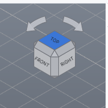
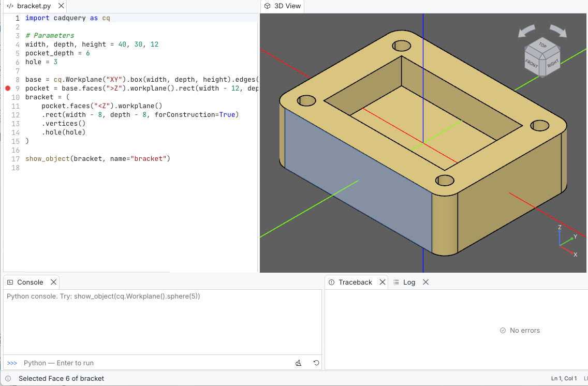

# 3D view

The 3D view draws every visible object with GPU shading, 4× anti-aliasing and
constant-width edges. The camera is controlled with the mouse, the
navigation cube and the View menu.

## Mouse

| Action | Control |
| --- | --- |
| Orbit | Left drag |
| Pan | Middle drag, or Ctrl + left drag |
| Zoom | Mouse wheel or touchpad pinch (zooms toward the pointer), right drag, or Shift + left drag |
| Select | Left click on a face, edge or vertex |
| Add to / remove from the selection | Ctrl + click |
| Clear the selection | Click on empty space |
| Zoom to an object | Double-click it |

While the view is being orbited or panned, the pointer becomes a closed hand
to make it clear that the camera is being held and moved. A click without a
drag still selects the object under the pointer.

The floating zoom controls in the top-left corner offer precise adjustments
without a mouse wheel. Use the magnifying-glass buttons for small steps or drag
the logarithmic slider to a specific percentage. **100%** is the framing set by
the most recent **Fit** or **Zoom to Selection** command.

**Orbit method** (*Preferences > 3D View*):

* **Turntable** (default) rotates around the world Z axis and the screen's
  horizontal axis, so Z always stays up. This is the most comfortable mode
  for mechanical parts.
* **Trackball** rotates freely, like rolling a ball under the pointer.

## Navigation cube



The cube in the top-right corner always shows the current orientation.

* Click one of its **6 faces** to look straight at that side (TOP, FRONT,
  RIGHT, …).
* Click one of its **12 edges** or **8 corners** to look from that diagonal.
* Click the **two curved arrows** above it to roll the view by 45°.
* Hovering highlights the part that will be clicked.

The axes indicator in the bottom-right corner shows the X (red), Y (green)
and Z (blue) directions. Both can be hidden in *Preferences > 3D View*.

## Standard views and framing

| Command | Shortcut | Toolbar |
| --- | --- | --- |
| Fit (frame all visible objects) | Shift+F1 | ⛶ |
| Iso · Top · Bottom · Front · Back · Left · Right | Shift+F2 … Shift+F8 | cube icons |
| Zoom to Selection | View menu, or double-click | |

View changes are animated. Turn this off with *Animate view changes*. With
*Fit automatically* (on by default), the view frames the model after every
run. The first model shown is always framed.

### Named views

A named view is a camera saved under a name: the point it looks at, its
direction, its zoom and its projection. The toolbar's bookmarks button,
after the standard views, opens the list:

* click a name to go back to that view (animated like the standard views);
* ⟳ replaces a view with the current camera, 🗑 deletes it;
* type a name and press **Save** (or Enter) to save the current camera;
  without a name it becomes *View 1*, *View 2*…, and an existing name is
  replaced.

**View > Named Views** lists the same views and has **Save Current View**.

Named views belong to the file: they are remembered with the preferences
for the 100 most recently used files and come back when the file is opened
again. A new, unsaved script keeps its views in memory and takes them along
when it is first saved. The display mode, section and exploded view are not
part of a named view.

## Display modes and projection

| Command | Shortcut |
| --- | --- |
| Wireframe (edges only) | Shift+F9 |
| Shaded | Shift+F10 |
| X-Ray (see-through faces) | Shift+F11 |
| Hidden Line (visible edges, hidden ones dashed) | Shift+F12 |
| Perspective Projection (toggle) | View menu |

**X-Ray** draws faces at 30% opacity (less if the object is already more
transparent), so every edge shows through and inner features stay visible.
**Hidden Line** fills faces with the background color: they hide what is
behind them, which leaves a line drawing of the visible edges. Hidden
edges are drawn as faint dashes; turn *Hidden edges* off in *Preferences >
3D View* for visible edges only. In this mode a [section](#section-view)
is hatched in the edge color.

In Shaded and X-Ray modes each object can show or hide its own edges: the
**Edges** checkbox in the Objects panel's property sheet overrides *Show
edges* for that object (**Reset** follows the preference again). Wireframe
and Hidden Line always draw edges, and wires and points are always drawn.

The default projection is **orthographic**, the usual choice for CAD because
parallel lines stay parallel. The menu toggle and *Preferences > 3D View >
Projection* change the same setting, which is remembered.

## Section view

**View > Section View** (toolbar scissors icon) cuts the model with a plane
to show its inside. The plane starts in the middle of the visible objects,
and a bar at the bottom left of the view controls it:

| Control | Effect |
| --- | --- |
| X · Y · Z | The axis the plane is perpendicular to; changing it recenters the plane |
| ⇅ | Keep the other side (by default the side towards +X, +Y or +Z is removed) |
| Slider | Position of the plane along the axis, in model units; the range covers the visible objects and any value can be typed |
| Fill | Fill the cut faces of solids with a darker shade of their color |
| ✕ | Remove the section |

What the plane removes cannot be selected: clicks go through to what is
behind the plane, so faces and edges inside the model can be picked. The
axes, the grid and the CQ Inspector overlay are not cut.

The cut faces are filled wherever the cut goes through material, which
assumes closed solids. An open shell or a face shows no fill, and so do
places where several solids overlap each other an even number of times.
The section is a view setting: it is not saved, and exports always contain
the whole model.

## Exploded view and isolation

**View > Exploded View** (toolbar arrows icon) moves the parts of the
shown objects away from their common center, so the parts of an assembly
can be seen and picked one by one. Each part moves along the line from the
center to its own center. The bar at the bottom left of the view sets how
far, from 0% (assembled) to 200% (three times as far from the center as
assembled); the view opens at 50%, and ✕ assembles the parts again.

Parts are what an assembly is made of: each `add`ed shape (with *Merge
assemblies* too) or each object shown with `show_object`. The solids of a
single shape stay together.

**View > Isolate Selection** (also in the Objects panel's right-click menu)
shows only the selected objects, with their parts and children, until
**End Isolation**; a bar at the bottom left of the view says what is
isolated and has both buttons. The checkboxes of the Objects panel are left
as they are: isolated objects that were hidden stay hidden, and the objects
hidden by the isolation are grayed in the tree. **Show All** ends the
isolation and makes every object visible again.

Fit, Zoom to Selection, the section plane and picking all work on what is
shown, where it is shown. The exploded view spreads what is shown: isolate a
sub-assembly to explode it around its own center. Measurements, selectors
and exports always use the real, assembled placement. Isolation follows the
objects by name when the script runs again, and ends by itself when none of
the isolated objects is left.

## Selection

Selection works at two levels.

**Objects.** Clicking an object selects it in the view and in the Objects
panel. The selected object is tinted and the property sheet shows its
details. Export, upload, *Zoom to Selection* and *Remove selected* act on the
selected objects.

**Topological entities.** The selection control at the right of the toolbar
chooses **Auto**, **Object**, **Face**, **Edge** or **Vertex**. Auto preserves
the usual nearest vertex-before-edge-before-face behavior. The explicit modes
make dense models easier to pick without accidentally selecting another kind.
When a topological mode is active, a click identifies the exact entity:

* the entity is highlighted on its own;
* the status bar reports it, for example *Selected Face 6 of bracket*;
* the property sheet in the Objects panel shows the id and part, for example
  *Face 6 · part 1*, with the area, length, radius and center of the entity;
* the Measurements panel reports exact geometric properties from OCCT.



Faces are hit-tested exactly. Edges and vertices only need the pointer within
6 pixels, and a face in front of them hides them. Ids are 1-based and follow
OpenCascade's topology order for the current shape. They are valid only for
that displayed scene entry: rebuilding or remodeling can assign the same id
to a different subshape. They are therefore selection handles, not persistent
topological names.

### Exact measurements

Select one face, edge or vertex to see its geometry type, center and the
properties that apply: vertex position, edge length, face area, radius and
diameter, and its **bounding box** (size, minimum and maximum). With no
entity picked, the panel measures the **selected objects** instead: volume,
area, center of mass, the number of solids, faces, edges and vertices, and
their bounding boxes. Several entities or objects also get one bounding
box around all of them.

Bounding boxes come from the exact geometry. CadQuery's own
`BoundingBox()` uses the triangulation of a shape once it has one, and
every shape on screen has been meshed: for a sphere of radius 5 it reports
about 5.04. Ctrl+click a second entity to add exact minimum distance and closest
points. Two straight edges or two planar faces also report their smaller
angle; a straight edge and planar face report the edge-to-plane angle.

The viewer's triangles and `f32` coordinates are used only to find what was
clicked. The Measurements panel asks the Python worker to calculate every
displayed value from the corresponding world-space OCCT geometry in double
precision. Curved-edge length and distances are consequently independent of
the display tessellation. Ctrl+click keeps adding entities (up to 64; the
oldest makes room for the newest), and Ctrl+clicking a selected entity
removes it. The relationship is shown when exactly two are selected.

### Selection to code

A picked face, edge or vertex also gets a **CadQuery selector**: the
expression that selects exactly the picked entities in the script, such as
`.faces(">Z")`, `.edges("|Z and >Y")` or, for several picked edges,
`.edges("|Z")`. The Measurements panel and the Objects property sheet show
it with **Copy** and **Insert**; *Edit > Copy Selector* and *Edit > Insert
Selector* (Ctrl+Shift+I) do the same, and the *Alternatives* list offers
other selectors for the same entities.

Selectors are found among direction selectors (`>Z`, `<X`, `|Z`, `#Y`,
`+X`, `-Z`), geometry types (`%CYLINDER`, `%CIRCLE`), ranks (`>Z[-2]` is the
second highest among those parallel to Z, `>>X[-3]` the third largest X of
all), inclined directions (`+(1,0,1)`) and their combinations with `and`,
`or` and `exc`. Simpler and more meaningful selectors come first. Each one
shown was applied by CadQuery to the object as the script holds it and
selected exactly the picked entities; for an assembly part, that is the
part's own object in its own coordinates.

When no such selector exists, an index is offered instead, such as
`.faces()[5]`, with a warning: it follows CadQuery's entity order and can
select another entity once the model changes. Selectors are generated for
workplanes and shapes; a picked sketch has none.

**Copy as code** puts Python on the clipboard that measures the same
entities or objects again, from the script's variables: a selector for
each picked entity (see below), placed as shown for assembly parts, then
one line per value with the measured value as a comment:

```python
face_1 = plate.faces(">Z").val()
area_1 = face_1.Area()  # 40
bounds_1 = exact_bounds(face_1)  # (10, -5, -2, 10, 5, 2)
distance = face_1.distance(edge_2)  # 20
```

Before copying, the worker runs that code on a copy of the console's
namespace and compares every value with the measurement; the status bar
says whether it checked out. When an object is not a variable of the
script, the code says `obj` and the status bar explains it. The code needs
the variables of the last run, so it is not available while debugging.

Hovering an object highlights it before you click.

## Appearance

These options live in *Preferences > 3D View*:

| Setting | Default |
| --- | --- |
| Background color | dark gray (95, 95, 95) |
| Use gradient, Background color (aux) | off; (30, 30, 30) at the bottom |
| Default object color | gold (255, 215, 0) |
| Show edges, Edge color, Edge width | on; black; 1.5 px |

Individual objects can be recolored from the script (`show_object` options)
or in the Objects panel.

## Mesh quality

The view displays a triangle mesh of the exact CAD geometry. Two settings
control how fine it is (*Preferences > 3D View*). They apply from the next
run.

| Setting | Default | Meaning |
| --- | --- | --- |
| Deviation | 0.001 | Maximum distance between mesh and surface, relative to the object size |
| Angular deviation | 0.2 rad | Maximum angle between neighboring mesh facets |

Smaller values give smoother curves but take more time and memory. Meshes
are cached by content: re-running a script whose parts did not change reuses
the previous meshes, and identical parts in an assembly are meshed only once.

Export precision is set separately (see [Exporting](exporting.md)).

## Screenshots

**Tools > Screenshot…** (toolbar camera icon) saves the 3D view as a PNG
image.
